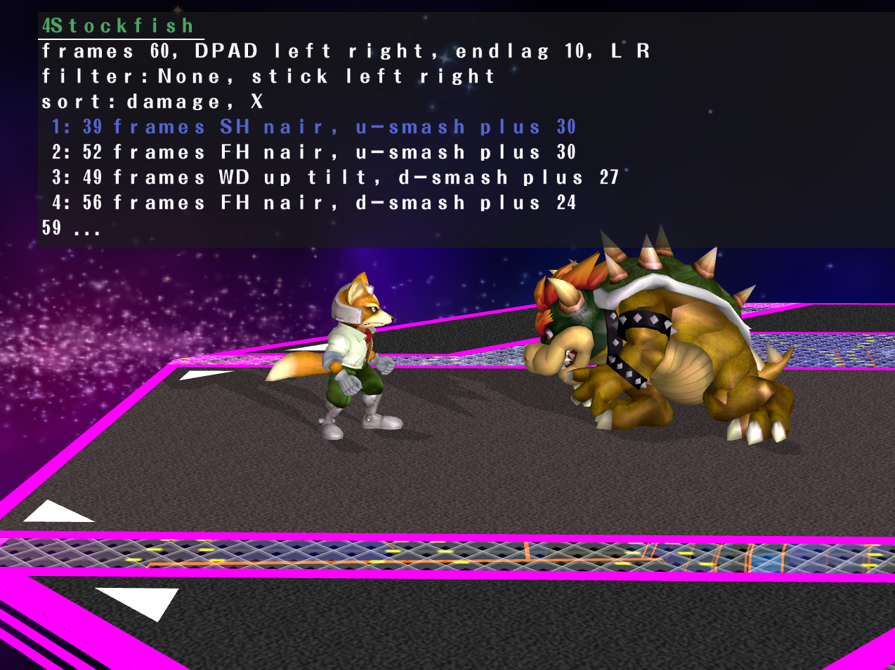

# 4Stockfish

4Stockfish is a Super Smash Bros. Melee "chess engine". Designed to be used for replay analysis, to answer the question, "What could I have done better in this situation?".

It works by actually simulating the game and searching many different state trees. It then lists the combos it found to the player, ordered by most damage done, or KO. You can also filter to see combos which contain a certain move, or sort by combo length instead.

## Screenshots

 |

## Controls

### During gameplay:

|Button|Action|
|------|------|
|Start|Begin/end search|

### During search:

|Button|Action|
|------|------|
|Start|end search|

### Viewing combos:

|Button|Action|
|------|------|
|Start|Resume gameplay|
|A|Preview combo|
|X|Toggle sort (damage/frame length)|
|Control-stick up/down|scroll|
|Control-stick left/right|Change move filter|
|D-Pad left/right|Increase/decrease frame search window (restarts search)|
|L/R triggers|Increase/decrease allowed endlag in-between hits (restarts search)|

## Current limitations
1. Opponent DI or teching is not yet implemented into the search space. Of course adding this will make the search much more complex and take longer. But I'm sure it's doable.
1. Search obviously does not simulate every single possibility, although the current search algorithm is a good mix between decently quick processing time and diverse combos that it generates.
1. Only tested on certain characters so far (marth, fox)
1. Only tested against CPUs so far
1. Only works in-game by hitting start. Ideally there'd be an "analyze-mode" which you can feed your .slp replays and, like a chess analysis engine, would recommend areas where you could improve.

## Future additions
1. opponent influence
    1. opponent DI - only show combos that work on all DIs - come up with UI and memory cache system to be able to quickly view all splits
    1. opponent rolls and tech

1. Combos are also labled from 1-10 based on difficulty
    1. Difficulty is based on how tight the inputs are (X frame of leeway? instant SH nair, etc..)

1. Practice mode to try and repeat the selected combo

1. position eval - based off actual positioning of characters on screen
    1. off stage = bad
    1. above other character = bad
    1. no dj = bad
    1. also frame advantage && distance to each other

1. slippi file replay viewer, recommend places for improvement, things to practice (low difficulty, high % difference)
    1. start with loading slippi file

## Documentation

Please see the great work over at https://github.com/999sian/melee-pc for full documentation details of the melee pc port. This project wouldn't be possible without them.

## License

Three situations, spelled out in [LICENSE.md](licenses/LICENSE.md): the decompiled
game code in `src/melee` and `src/sysdolphin` is **not licensed** and remains
the property of its copyright holders; the port code in `src/pc`, `tools`,
`platforms`, `cmake` and `.github` is **GPL-3.0-or-later** ([COPYING](licenses/COPYING));
bundled third-party components keep their own licenses. Because the game code
cannot be relicensed, the repository as a whole is not distributable under the
GPL. No game assets are in this repository.

Builds read their release version from the root `VERSION` file. Release tag
builds use the tag; `MELEE_VERSION` overrides the default for packaging, and
`-DMELEE_VERSION=<version>` overrides it in CMake.
